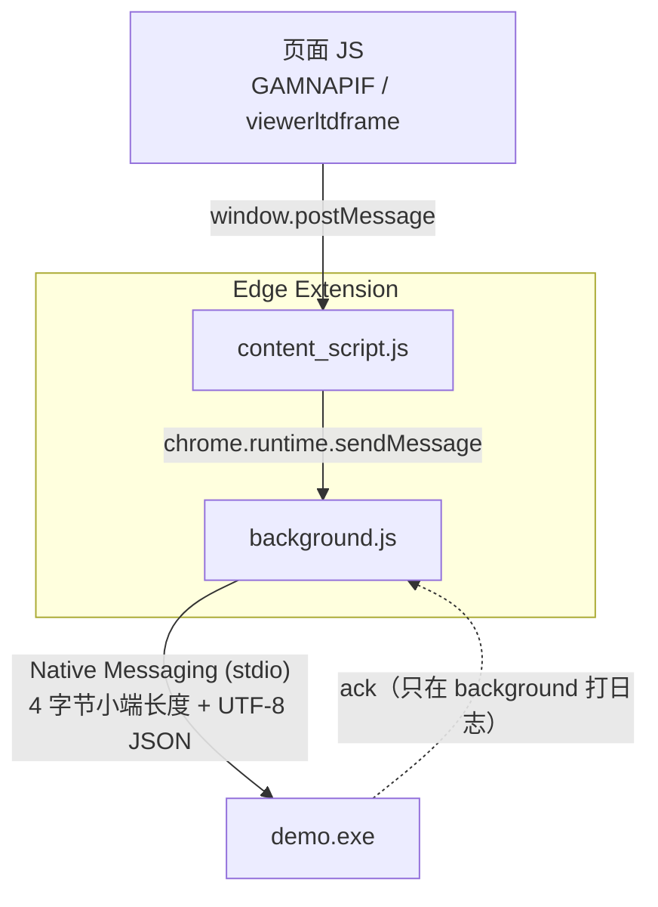
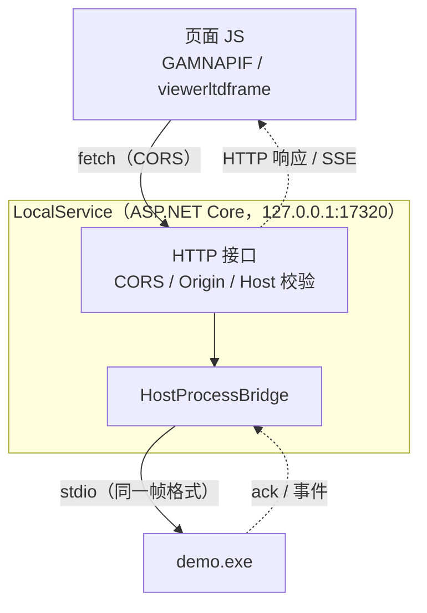
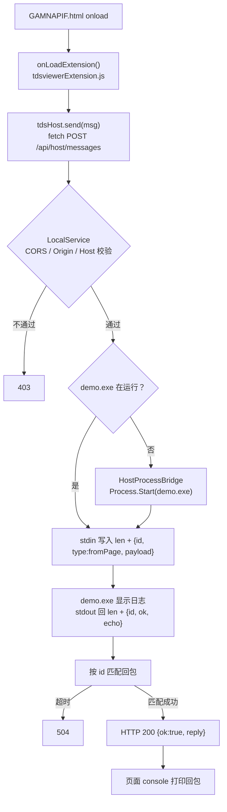
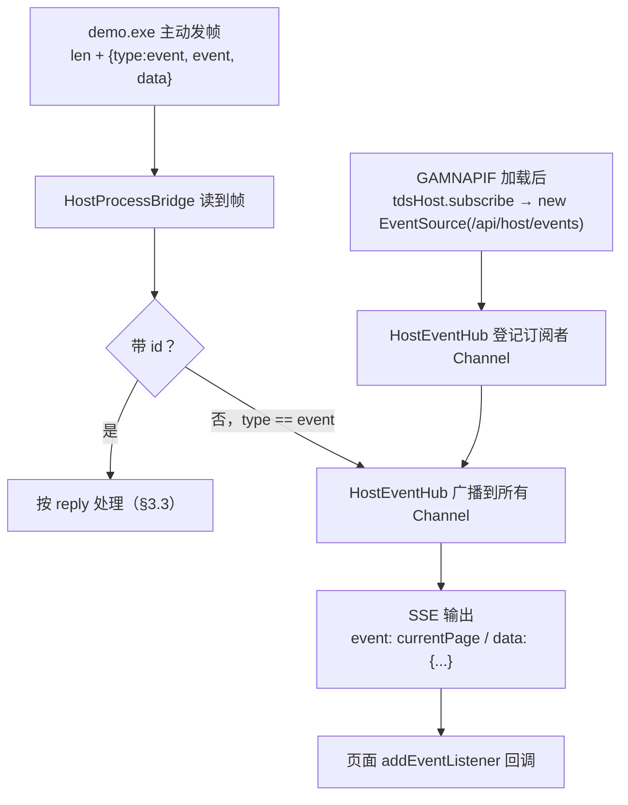

# 改造说明：用本地 ASP.NET Core WebAPI 替代 Edge Extension

> 状态：**核心决策已确认（2026-10-08），未实施**。本文只解释改动内容与理由，代码改动另行提交。已确认/待定事项见 §9。

## 1. 背景与目标

原系统用 Java Applet 让 JSF 页面调用本地能力；Applet 被淘汰后，本 PoC 先用 **Edge Extension + Native Messaging** 打通了「页面 ↔ 本地 C# 程序（`demo.exe`）」。

扩展方案的问题：

- 每台客户端都要装扩展、开开发者模式或走企业策略分发；
- 扩展 ID 与 `com.demo.host.json` 的 `allowed_origins` 强绑定，ID 变了就要改清单；
- 要写注册表 `HKCU\Software\Microsoft\Edge\NativeMessagingHosts\...`；
- 绑死 Edge（换 Chrome 要再注册一套）。

**目标**：新增一个运行在本机的 **ASP.NET Core WebAPI 本地服务**（下称 *LocalService*），取代扩展的「桥梁」角色：

- 页面 JavaScript 直接用 `fetch` 调用 `http://127.0.0.1:<端口>` 上的 LocalService；
- LocalService 负责和 `demo.exe` 通信。

## 2. 架构对比

### 改动前（扩展方案）



### 改动后（本地 WebAPI 方案）



对应关系：

| 扩展方案中的角色 | WebAPI 方案中的替代者 |
|---|---|
| `content_script.js`（接收页面消息） | LocalService 的 HTTP 接口 |
| `background.js`（`connectNative` 拉起并持有 host） | LocalService 内的 `HostProcessBridge`（`Process.Start` 拉起并持有 `demo.exe`） |
| Edge 浏览器进程（负责 stdio 收发） | LocalService 进程 |
| `com.demo.host.json` + 注册表 | LocalService 的 `appsettings.json`（配置 exe 路径） |
| `window.postMessage(... '*')` | `fetch('http://127.0.0.1:17320/api/...')` |

## 3. 核心设计决策

### 3.1 LocalService ↔ demo.exe：沿用 stdio + 长度前缀帧（已确认）

> ✅ 已确认（2026-10-08）：`demo.exe` 由 LocalService 按需拉起。

LocalService **扮演原先 Edge 的角色**：用 `Process.Start` 启动 `demo.exe`，重定向 stdin/stdout，按「4 字节小端长度 + UTF-8 JSON」读写。

理由：

- `demo.exe` 现有的 `ReadLoop` / `SendMessage` / `IsShutdownMessage` **几乎不用改**，协议、帧格式、「stdout 只能走协议、不能打日志」的约束全部照旧；
- WinExe 在 stdio 被重定向时 `Console.OpenStandardInput()` 照常可用（Edge 本来就是这么拉起它的）；
- 生命周期清楚：LocalService 按需拉起 exe、持有进程句柄，exe 退出后下次请求再拉起。

备选方案：**Named Pipe**（`System.IO.Pipes`）。适用于「`demo.exe` 需要由用户独立启动、先于 LocalService 存在」的场景。代价是 exe 要从 stdio 改成管道服务端。帧格式可以不变，只换传输层。若后续有此需求再切换，接口层不受影响。

> 不推荐把 WebAPI 直接塞进 `demo.exe` 合成一个进程：这虽然最简单，但与「本地服务和 exe 分离」的目标不符。

### 3.2 页面 JS ↔ LocalService：HTTP 请求-响应 + SSE 推送

- **页面 → 本地**：`fetch` POST JSON。`demo.exe` 的 ack 作为 HTTP 响应体同步返回，页面可以直接拿到结果；扩展方案里 ack 只在 background 打日志，页面拿不到。
- **本地 → 页面（主动推送）**：exe 主动通知页面（例如原 `CurrentPageLeadToolExtension` 要拿回 `currentPage`）用 **SSE（`EventSource`）**。它单向、基于普通 HTTP、浏览器自带断线重连，比 WebSocket/SignalR 轻。

> ✅ 已确认（2026-10-08）：需要本地 → 页面的主动推送，**SSE 纳入第一阶段**。设计细节见 §3.4。

### 3.3 请求与回包的对应（关联 ID）

HTTP 是请求-响应模型，stdio 是一条共享流。LocalService 发给 exe 的每条消息带 `id`，exe 回 ack 时原样带回 `id`，LocalService 用 `id → TaskCompletionSource` 把回包交给对应的 HTTP 请求，并设置超时（例如 5 秒）。

为此 **`demo.exe` 需要一处小改**：ack 中回传 `id`（见 §6.3）。

### 3.4 主动推送（SSE）设计

**exe → LocalService：靠字段区分两类帧。** stdout 上同一条流里会混着两类帧：

| 帧类型 | 判定 | 示例 | LocalService 处理 |
|---|---|---|---|
| 回包（reply） | 带 `id` | `{ "id": "c0a8…", "ok": true, "echo": "..." }` | 交给等待中的 HTTP 请求（§3.3） |
| 事件（event） | `type == "event"`，不带 `id` | `{ "type": "event", "event": "currentPage", "data": { "page": 3 } }` | 广播给所有 SSE 订阅者 |

无法识别的帧只记日志、丢弃，不让读循环中断。

**LocalService → 页面：广播。**

- `HostEventHub` 单例为每个 SSE 连接分配一个 `Channel<T>`；收到 event 帧时写入所有 Channel，连接断开（`RequestAborted`）时移除对应 Channel。
- `GET /api/host/events` 用 .NET 10 内置的 `TypedResults.ServerSentEvents(IAsyncEnumerable<SseItem<T>>)` 输出，不需要手写 `text/event-stream` 格式。
- SSE 的 `event:` 字段填帧里的 `event`（如 `currentPage`），`data:` 填帧里的 `data`（JSON）。页面用 `es.addEventListener('currentPage', ...)` 按事件名订阅。
- **心跳**：每 15 秒发一条 SSE 注释行（`: ping`），防止连接被中间设备闲置断开，也能让服务端及时发现失效连接。
- exe 退出时广播一条 `hostExited` 事件，页面据此更新状态。exe 不在运行时没有事件源，这是预期行为，不需要缓存补发。PoC 不实现 `Last-Event-ID` 断点续传。

**页面侧：每个页面只建一条 `EventSource`。**

- 订阅放在 `GAMNAPIF.html` 所在帧（`imgF`），由 `tdsHost.subscribe(eventName, handler)` 统一管理；其它帧需要事件时，由 `imgF` 用现有的 `postMessage` / 直接调用分发。
- 原因：页面到 `http://127.0.0.1` 走的是 HTTP/1.1（浏览器不支持明文 HTTP/2），**同一主机最多 6 条并发连接**。每条 `EventSource` 长期占用一条连接。如果多个帧、多个标签页各开一条，会占满连接池，导致后续 `fetch` 一直排队挂起。
- `EventSource` 跨源同样走 CORS，复用 §5.1 的白名单；不设置 `withCredentials`。

## 4. 接口定义（草案）

基地址：`http://127.0.0.1:17320`（端口可在 `appsettings.json` 配置，页面侧常量同步）

| 方法 | 路径 | 用途 | 请求体 | 响应 |
|---|---|---|---|---|
| `GET` | `/api/health` | 页面探测本地服务是否在线 | — | `{ "ok": true, "hostRunning": bool }` |
| `POST` | `/api/host/messages` | 发消息给 `demo.exe` 并等待 ack | 页面消息 JSON（见下） | `{ "ok": true, "reply": {...} }` |
| `POST` | `/api/host/shutdown` | 通知 `demo.exe` 关闭 | 可空 | `{ "ok": true }` |
| `GET` | `/api/host/events` | SSE，接收 exe 主动推送（见 §3.4） | — | `text/event-stream` |

页面发出的消息体保持与现在相同的字段，只去掉扩展专用的 `__tdsviewer` 标记：

```json
{ "type": "onLoadExtension", "from": "GAMNAPIF", "text": "hello from GAMNAPIF onload" }
```

LocalService 转发给 exe 时**沿用现有信封结构**，这样 `IsShutdownMessage` 的 `payload.data.type` 判断无需改动：

```json
{ "id": "c0a8…", "type": "fromPage", "payload": { "from": "webapi", "data": { "type": "shutdown", "...": "..." } } }
```

失败语义：exe 拉起失败 / 超时 → HTTP `502` / `504`，响应体 `{ "ok": false, "error": "..." }`。页面据此提示「本地服务未就绪」。

## 5. 必须处理的浏览器与安全问题

### 5.1 CORS

页面和 LocalService 不同源，必须配置 CORS，否则 `fetch` 被浏览器拦截：

- 允许的 Origin **白名单**，不能用 `AllowAnyOrigin`：
  - 真实 JSF 服务器的 origin（例如 `http://jsf-server:8080`），本地联调时为 `http://localhost:8080`（`jsf12-env`）；
  - 用 `file://` 直接打开页面时 Origin 为字符串 `"null"`。**仅开发环境**放行 `null`，生产配置中去掉，因为任何本地 HTML 文件都带 `null`。
- `Content-Type: application/json` 会触发 **预检（OPTIONS）**，ASP.NET Core 的 CORS 中间件会自动应答，无需手写。

### 5.2 Local Network Access（本地网络访问限制）

Chromium（含 Edge）在逐步收紧「网页访问 localhost / 内网」：从**公网**页面请求 `127.0.0.1` 会触发权限弹窗，或被拦截。

- 如果 JSF 页面部署在**内网地址**，通常不受影响；
- 如果来自公网域名，需要通过企业策略预授权该站点（Edge 有对应的策略项），或者让用户在首次弹窗时允许。

**这是该方案最大的外部风险，需要在目标 Edge 版本上实测。**

> ✅ 已确认（2026-10-08）：**JSF 页面部署在内网**。风险比公网来源低很多，但上面「通常不受影响」的说法需要收紧：
> - 在 Chromium 的地址空间分级里，回环（`127.0.0.1`）比内网私有地址更「私密」。按照不同版本的实现，**内网页面访问回环仍有可能被视为本地网络访问而弹窗**，结论以目标 Edge 版本实测为准；
> - 如果实测出现弹窗或拦截，用 Edge 企业策略把内网 JSF 站点加入本地网络访问的允许列表（例如 Chromium 的 `LocalNetworkAccessAllowedForUrls`，以目标 Edge 版本的策略文档为准）。内网环境一般都有域策略下发渠道，落地成本低；
> - 联调用的 `jsf12-env`（`http://localhost:8080`）本身也是回环，**测不出这个问题**。必须用另一台内网机器上的 JSF 页面做一次验证（见 §8）。
>
> 相应地，§5.1 CORS 生产白名单 = **内网 JSF 服务器的 origin**（协议 + 主机名/IP + 端口，必须与浏览器地址栏完全一致；同一服务器如果既能用主机名又能用 IP 访问，两种都要列上）。

另外：`http://127.0.0.1` / `http://localhost` 被浏览器视为「潜在可信」源，因此即使 JSF 页面是 HTTPS，也**不会**被当作混合内容拦截。

### 5.3 本地服务的安全面

扩展方案只有「装了扩展 + ID 在白名单」才能调用 host；本地 HTTP 服务则**本机任何网页都能尝试访问**。需要以下防护：

1. **只监听回环地址**：`Kestrel` 绑定 `http://127.0.0.1:17320`，不能用 `0.0.0.0` / `*`，避免局域网其它机器调用；
2. **CORS 白名单**（§5.1）。注意 CORS 只能限制浏览器读取响应，**不能**阻止「简单请求」被发出，所以第 3、4 条不可省；
3. **校验 `Host` 头**（`AllowedHosts = "127.0.0.1;localhost"`），防 DNS rebinding；
4. **服务端再校验 `Origin` 头**：非白名单直接 `403`，并且强制要求 `Content-Type: application/json`。这样跨站的简单表单 POST 打不进来；
5. 后续可加一次性 token，由 JSF 页面渲染时下发，PoC 阶段暂不做。

### 5.4 关闭流程：请求不能被页面跳转打断

`viewerMiddleware.js` 的 `shutdown()` 发消息后 200ms 就把帧导航到 `about:blank`。扩展方案下消息已经交给扩展进程，不受影响；换成 `fetch` 后，**文档销毁会取消未完成的请求**。

改法（二选一）：

- `fetch(url, { method: 'POST', keepalive: true, ... })`：页面卸载后请求仍会发完（推荐）；
- 或者 `await` 关闭请求完成后再导航。

不使用 `navigator.sendBeacon`：它不能发送带 `application/json` 的跨源请求，和 §5.3 第 4 条冲突。

### 5.5 LocalService 由谁启动

扩展方案里 Edge 会按需拉起 host；WebAPI 方案里 **LocalService 必须先在运行**，页面才连得上。

- **不要注册成 Windows 服务**：服务运行在 Session 0，拉起的 `demo.exe` 窗口**用户看不到**（Session 0 隔离）；
- 推荐以**当前用户身份**在登录时自启，用「任务计划程序 → 登录时触发」，或 `HKCU\...\Run` 注册表项；
- PoC 阶段手动 `dotnet run` 即可。页面通过 `/api/health` 探测，服务不在时给出明确提示。

> ✅ 已确认（2026-10-08）：
> - **当前（PoC）**：直接双击或命令行启动发布出来的 `LocalService.exe`。
> - **生产**：最初计划注册为 Windows 服务，因为上面的 Session 0 问题，**改为按当前用户登录自启**。

登录自启的实现：

- **采用 `HKCU\Software\Microsoft\Windows\CurrentVersion\Run`**，值名 `JsfHandlerLocalService`，值为 `LocalService.exe` 的绝对路径（带引号）。写 HKCU 不需要管理员权限，进程以当前用户身份运行在用户会话中，拉起的 `demo.exe` 窗口可见。
- 备选方案是任务计划程序（「登录时」触发）。它支持「失败后重启」，但用 `schtasks /SC ONLOGON` 创建通常需要管理员权限。生产如果要求崩溃自恢复，再切换过去。
- 由 `install-autostart.ps1` / `uninstall-autostart.ps1` 写入或删除该注册表值（含中文时要存为 UTF-8 BOM）。

配套要求：

- **不弹控制台窗口**：`LocalService.csproj` 设 `<OutputType>WinExe</OutputType>`，Web 项目同样适用。日志改写到文件（`%LOCALAPPDATA%\JsfHandler\logs\`），不依赖控制台。
- **单实例**：启动时获取命名 `Mutex`（`Local\JsfHandlerLocalService`），已有实例在运行则直接退出。这样可以避免手动启动和自启动同时运行，第二个进程抢端口失败。
- **端口被占用**：Kestrel 绑定失败时记日志并退出码非 0，不静默挂起。
- 用户注销时 LocalService 随会话结束，`demo.exe` 一并退出；LocalService 退出时主动结束自己拉起的 `demo.exe`，不留孤儿进程。

## 6. 文件改动清单

### 6.1 新增：`local-service/`（ASP.NET Core WebAPI，.NET 10）

| 文件 | 说明 |
|---|---|
| `LocalService.csproj` | `Microsoft.NET.Sdk.Web`，`net10.0`；`OutputType=WinExe`（不弹控制台）、`AssemblyName=LocalService` |
| `Program.cs` | Minimal API：单实例 `Mutex`、注册 CORS / AllowedHosts / Origin 校验中间件、映射 §4 的接口、文件日志 |
| `HostProcessBridge.cs` | 单例服务：按需 `Process.Start(demo.exe)`（重定向 stdin/stdout）；后台循环读 stdout 帧，按 §3.4 区分 reply / event；`id → TaskCompletionSource` 关联回包；监测进程退出；LocalService 停止时结束 `demo.exe` |
| `HostEventHub.cs` | 单例：SSE 订阅者管理（每连接一个 `Channel<T>`）、事件广播、15 秒心跳 |
| `appsettings.json` | `Urls`（`http://127.0.0.1:17320`）、`AllowedHosts`、`Cors:AllowedOrigins`（内网 JSF origin）、`Host:ExePath`、`Host:ReplyTimeoutMs` |
| `appsettings.Development.json` | 开发期额外放行 `null`（`file://`）和 `http://localhost:8080`（`jsf12-env`） |
| `install-autostart.ps1` / `uninstall-autostart.ps1` | 写入/删除 `HKCU\...\Run` 下的 `JsfHandlerLocalService`（§5.5） |

说明：用 Minimal API 而不是 Controller，因为 PoC 只有 3～4 个端点，Minimal API 更直观；后续端点多了再迁 Controller，两者都属于 ASP.NET Core WebAPI。

### 6.2 修改：页面侧 JS

| 文件 | 改动 |
|---|---|
| `tdsviewerExtension.js` | 新增一个很薄的传输封装 `tdsHost`（`send(msg)` / `shutdown()` / `health()` 内部用 `fetch`；`subscribe(eventName, handler)` 内部懒建**唯一一条** `EventSource`，见 §3.4）。`onLoadExtension()` 从 `window.postMessage` 改为 `tdsHost.send(...)`，打印 exe 的回包，并订阅 exe 推送的事件 |
| `viewerMiddleware.js` | `shutdown()` 从 `window.postMessage` 改为 `tdsHost.shutdown()`（`keepalive: true`），导航逻辑保留 |
| `viewerltdframe.html` | 如 `shutdown()` 要用 `tdsHost`，需要引入 `tdsviewerExtension.js`（或把 `tdsHost` 拆成独立的 `tdsHost.js`，两处都引用） |

调用点（`onLoadExtension` / `shutdown` 等函数名）保持不变，HTML 的 `onload` 不用改。这符合「HTML 是 JSF 输出、视为既定输入」的约束。

`CurrentPageLeadToolExtension` 依赖弹出 `GAMNDUMMYEDGE.html` 小窗再回 `postMessage`，这是旧的「借扩展取当前页」流程，**本次不改**。后续可以改成 `GET /api/host/current-page`，或者通过 SSE 推送，详见 §7。

### 6.3 修改：`native-host/`（`demo.exe`）

改动很小：

- `MainForm.SendMessage` 的 ack 带回请求里的 `id`（解析入站 JSON 的 `id` 字段，原样回填），供 LocalService 关联回包；
- 新增主动推送能力：用 `SendMessage(new { type = "event", @event = ..., data = ... })` 发 event 帧（复用现有的 `_stdoutLock`，保证与 ack 帧不交错）。PoC 在工具栏加一个「推送测试」按钮，点一下发一条 `testEvent`，用来验证 exe → 页面整条链路；
- 日志文案中的「浏览器断开」改为更中性的「上游断开」；
- `.cs` 含中文，改完要补 UTF-8 BOM（见 CLAUDE.md）。

`com.demo.host.json`、`register-host.ps1`、`unregister-host.ps1` 在新方案中**不再需要**（不用写 Edge 注册表）。发布脚本可以简化为只 `dotnet publish` 出 `demo.exe`，供 LocalService 的 `Host:ExePath` 指向。

### 6.4 删除 / 下线：`extension/`

扩展目录整体下线。建议**等 WebAPI 方案联调通过后再删除**，期间两套可并存：页面只走 `tdsHost`，扩展装着也不会被触发，因为页面不再发带 `__tdsviewer` 的 postMessage。

### 6.5 文档

同步更新 `README.md`（安装/运行步骤：去掉加载扩展、回填 ID、允许文件 URL、写注册表；新增启动 LocalService）和 `CLAUDE.md`（架构图、数据流、注意事项）。

## 7. 新数据流（一次往返）



主动推送（exe → 页面）：



关闭：`business` 按钮 → `viewerMiddleware.shutdown()` → `POST /api/host/shutdown`（`keepalive`）→ exe 收到 `type:"shutdown"` 后回 ack 并退出 → LocalService 标记进程已退出，下次请求再拉起。

## 8. 实施步骤

1. 新建 `local-service/` 项目，先实现 `/api/health` + CORS + 回环绑定，在页面里用 `fetch` 跑通；
2. 实现 `HostProcessBridge`，打通 `POST /api/host/messages` → `demo.exe` 显示日志；
3. `demo.exe` 回传 `id`，接口拿到同步回包；
4. 改 `viewerMiddleware.shutdown()`，打通关闭流程（重点验证 `keepalive`）；
5. 实现 `HostEventHub` + `GET /api/host/events`，`demo.exe` 加「推送测试」按钮，页面 `tdsHost.subscribe` 收到事件；
6. 在 `file://` 和 `jsf12-env`（`http://localhost:8080`）两种来源下分别联调 CORS；
7. **内网实测**：从另一台内网机器访问 JSF 页面，确认 Local Network Access 是否弹窗或拦截；如果有，验证 Edge 策略放行（§5.2）；
8. 单实例、`WinExe` 无窗口、`install-autostart.ps1` 注销后重新登录自启验证；
9. 验证通过后下线 `extension/` 与 Native Messaging 注册脚本，更新 README / CLAUDE.md；
10. （后续）token 鉴权、`CurrentPageLeadToolExtension` 迁移到推送事件。

> ⚠️ 已废弃：原第 7 步「（可选）SSE 推送、登录自启、token 鉴权」。SSE 和登录自启已确认纳入第一阶段（第 5、8 步），token 移到第 10 步。

## 9. 待确认事项

### 决策记录（2026-10-08）

| # | 事项 | 结论 | 影响章节 |
|---|---|---|---|
| 1 | `demo.exe` 由谁启动 | LocalService **按需拉起**（stdio） | §3.1 |
| 2 | LocalService 部署形态 | PoC：直接启动 `LocalService.exe`；生产：原计划 Windows 服务，因 Session 0 问题**改为当前用户登录自启**（`HKCU\...\Run`） | §5.5、§6.1 |
| 3 | 本地 → 页面主动推送 | **需要**，SSE 纳入第一阶段 | §3.2、§3.4、§7 |
| 4 | JSF 页面来源 | **内网**；Local Network Access 风险低但需实测，CORS 白名单填内网 origin | §5.2、§5.1 |
| 5 | 扩展是否立即删除 | **联调通过后再删**，期间保留作回退 | §6.4 |

### 原始问题（保留）

1. **`demo.exe` 由谁启动**：由 LocalService 按需拉起（本文推荐，exe 几乎不改），还是用户独立启动、LocalService 通过 Named Pipe 去连？
2. **LocalService 部署形态**：PoC 阶段手动启动是否足够？生产是否要登录自启？
3. **是否需要本地 → 页面的主动推送**（决定第一阶段是否实现 SSE）？
4. **JSF 页面的真实来源**：内网地址还是公网域名？这决定 §5.2 Local Network Access 的风险大小，以及 CORS 白名单的取值。
5. **扩展是否立即删除**，还是保留一段时间作为回退方案？
